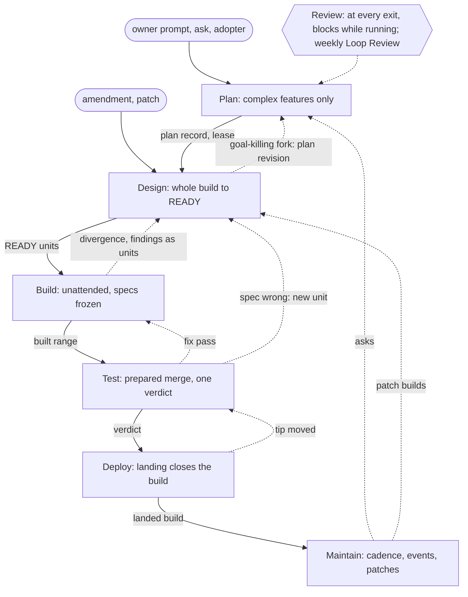

# Flow interactions — each step's scope, and how the steps hand off, return and feed back, as designed so far

**Serves:** research PLAY-dClosedLoop-1

The owner asked, before the lower layers: "let's first define what each STEP of the flow actually
entails - what's in scope, what's out of score, and how each step interacts with one another. What's
our current design of these interactions?" This record answers from the settled flow walk
(`build/2026-10-14-build-PLAY-dClosedLoop-1-flow.md`) and architecture v2, adds nothing new, and names
the interactions the design has not yet defined.

## [scope] What each step entails

| Step | In scope | Out of scope |
|---|---|---|
| Plan | intake recorded verbatim; triage by rules; disposition; the one plan record (problem, goal, cut-line, acceptance, priority, dependencies, each practice's Plan reach); placement in the plan view; ratification, which is the mandate; the build lease | mechanisms, units, specs, code, gates; re-planning an open build, which only a recorded plan revision does |
| Design | decomposition into features and units; each feature's design with its interfaces declared; each unit's structured spec; probes, alternatives, each practice's Design reach; fork resolution; overlaps from the design index; the spec audit where owed; in-goal amendments, re-designs and patch builds' micro-specs | product code; the goal or cut-line; gates beyond the spec-level checks |
| Build | passes per unit under the mandate; each unit's acceptance observations; the bug-class checklist witness; divergence sent back to Design; the scope check; the closing review and its findings disposed as units; no core red of its own standing | editing a spec; the merge bar; landing; re-planning |
| Test | the prepared merge with the default branch's tip; the bar on the declared backend; the declared product-test levels; held legs as policy says; attribution; flakes; seen-red records for new gates; the verdict written per tree | fixing code; landing; re-design |
| Deploy | the landing (merge, push, landing record, kit versions); the build's closure, at landing by default; the release per SHA (the engine's promotions, verifies, roll-forward); gov's tagged releases; leases released | code changes; re-verifying a stale tree; re-design |
| Maintain | runs on its cadence or on an event; the detectors; actions that change no tracked content (reaping, pruning landed branches); safe fixes as patch builds; asks filed; the tagged release cut; the slower test levels; adopter currency; the maintenance record and its metrics | product code; features; plan decisions |
| Review | each stage's lens set; the scored recommendation at every transition; a running review blocking its transition; dispositions made by the stage that owns the work; left-shift, a gate on a class's second occurrence; the value ledger; the weekly Loop Review filing proposals into Plan | editing what it reviews |

## [edges] How the steps interact

| # | From → to | Trigger | Carries | Witness |
|---|---|---|---|---|
| 1 | Plan → Design | ratification | the plan record, the build lease | the ratification record, the transition |
| 2 | Design → Build | every unit in scope derived READY | units with their order and write sets, unit leases | derived READY, the transition |
| 3 | Build → Test | every unit built and the closing review folded | the built range, each unit's acceptance record | history checks at the push, the transition |
| 4 | Test → Deploy | a verdict with no blocking red | the prepared-merge tree and its verdict | the verdict the hook wrote |
| 5 | Deploy → Maintain | the landing recorded | the landed build, its release duties | the landing record |
| 6 | Design → plan revision → Design | a fork the goal cannot survive | the evidence; the revised plan, ratified | the revision record |
| 7 | Build → Design | a divergence: the spec is wrong | the unit, at unit or feature level | the re-entry record |
| 8 | Build's review → Design | confirmed closing-review findings | new units, as `review.findings` disposes | the review report |
| 9 | Test → Build | an OWN red where the code misses its spec | a fix pass of the owning unit | the attribution |
| 10 | Test → Design | an OWN red where the spec is wrong | a new unit | the attribution |
| 11 | Deploy → Test | the default branch's tip moved | a stale verdict, re-verified | the verdict's tree differs |
| 12 | Maintain → Plan | findings, breaches, a red default branch | asks with a severity and an acceptance | the maintenance record |
| 13 | Maintain → Design | a safe fix that changes tracked content | a patch build | the maintenance record |
| 14 | Deploy's release → Plan | a failed verify after the build closed | an ask | the release record |
| 15 | Loop Review → Plan | its weekly cadence | proposals: retire, merge, re-derive a cap, change a contract | the Loop Review record |
| 16 | any step ↔ Review | owed by policy, a binding recommendation, or the owner | the step's artifact out; findings back, disposed by that step | the report; the transition held while it runs |
| 17 | owner, asks, adopters → Plan | an intake | the request, verbatim | the intake record |
| 18 | amendment or small change → Design | an in-goal amendment; a patch | a derived plan record for a patch | the intake; ratification as `patch.ratify` says |

## [shared] State the steps share

- **The plan view** (priority and dependencies): written by Plan, read by kickoff's card and by Maintain.
- **Leases** (build, unit, maintenance): taken at Plan's and Design's exits, released at Deploy.
- **The design index**: written and read by Design, read by Plan's duplicate check.
- **Verdict records per tree**: written by Test, read by Deploy, watched by Maintain on the default branch.
- **Transition records**, as trailer, log and micro-format: written at every boundary.
- **Gate health and the value ledger**: written by Test, Review and Maintain, read by the Loop Review.
- **The policy file and its preset**: read by every step.
- **The card**: written at session start, rendering the slice of the build the session works on.

## [open] Interactions the design does not yet define

1. **A build whose units are in different steps.** A mid-build amendment sends some units back to
   Design while others are built; nothing says what step the build is in, or when it may enter Test.
2. **What a dependency gates.** `parents:` orders builds in the plan; nothing says whether a dependent
   build may design, build or land before its parent has landed.
3. **A merge conflict in Test's prepared merge.** Nothing routes a conflict between a build and the
   default branch's tip.
4. **A patch build's Plan obligations.** A patch enters at Design with a derived plan record; nothing
   says which of Plan's checklist items it still owes.
5. **Landing order among builds verified at once.** The first landing makes the others' verdicts stale;
   nothing orders who lands first.
6. **The card across transitions.** One unattended session can carry a build from Design to Deploy;
   nothing says how the card's slice follows it.

## [diagram] Overview, in mermaid

